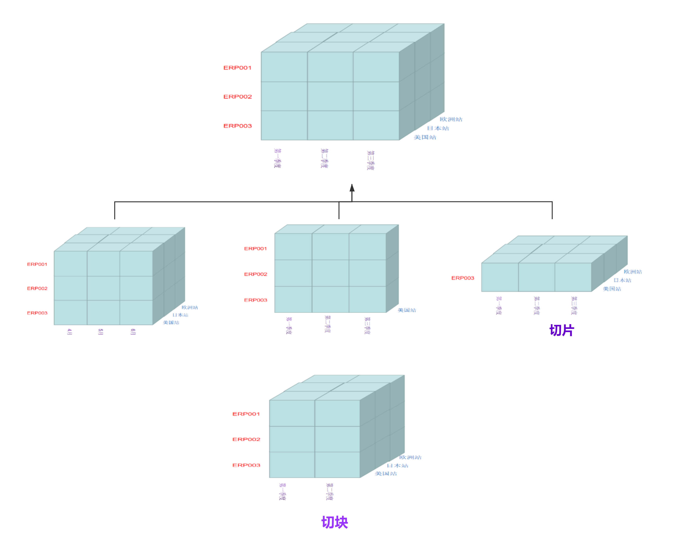
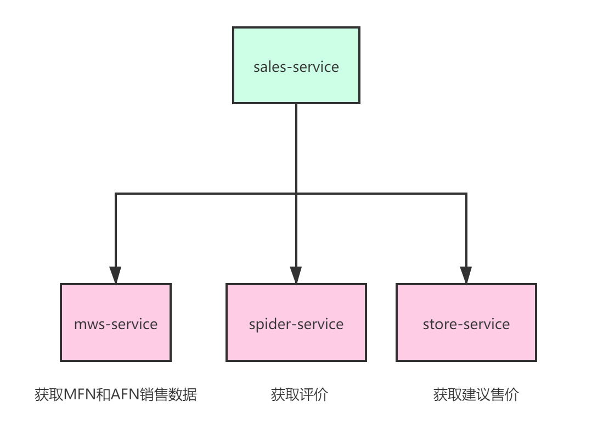
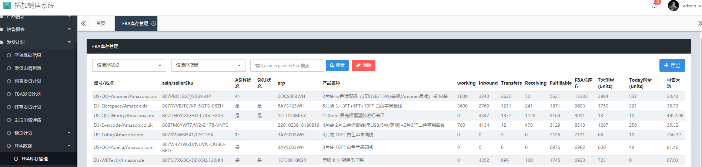
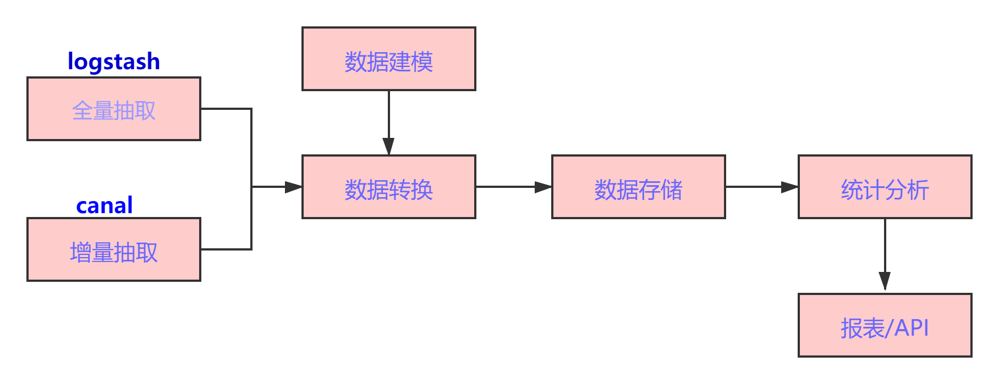
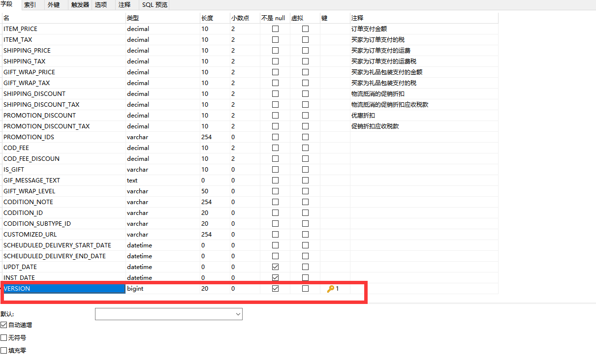
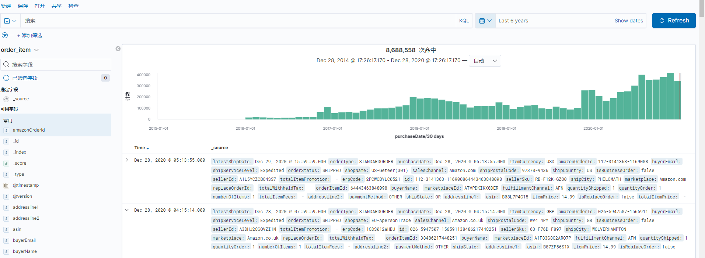
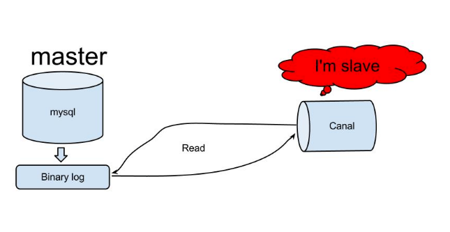
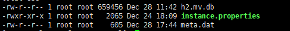

# 基于ElasticSearch构建OLAP系统

## OLAP

### 概述

当今的数据处理大致可以分成两大类：联机事务处理OLTP、联机分析处理OLAP。OLTP是传统的关系型数据库的主要应用，主要是基本的、日常的事务处理，例如银行交易。OLAP是数据仓库系统的主要应用，支持复杂的分析操作，侧重决策支持，并且提供直观易懂的查询结果。

### 典型操作

OLAP的基本多维分析操作有钻取（Drill-up和Drill-down）、切片（Slice）和切块（Dice）、以及旋转（Pivot）等。

#### 向上钻取

向上钻取是在某一维上将低层次的细节数据概括到高层次的汇总数据，或者减少维数，



#### 向下钻取

向下钻取刚好与向上钻取相反，它从汇总数据深入到细节数据进行观察或增加新维,例如第二季度的数据向下钻取，就是4,5，6月的维度分析

#### 切片和切块

切片和切块是在一部分维上选定值后，关心度量数据在剩余维上的分布。如果剩余的维只有两个，则是切片；如果有三个，则是切块

#### 旋转

旋转是变换维的方向，即在表格中重新安排维的放置（例如行列互换）。 

### 为什么需要OLAP ?

在回答这个问题之前，我们可以引出另外一个问题：微服务架构下，如何解决数据库跨库查询？微服务是将臃肿的单体服务，按照领域模型，进行微服务划分，每个服务都有明确的边界，只关心自己的业务。所以在做微服务架构或者重构的时候，会进行业务拆分。例如我们目前拆分出产品、销售、仓库、MWS、爬虫等各类业务系统，每个系统对应的都是独立的数据库，
那么在特定的业务情况下就需要进行涉及多个业务领域的数据汇总展示，那么如何去解决呢？

这里举几个例子：


#### 微服务架构下的跨库查询方案

##### 1、表字段冗余

想必大家已经很熟悉，几乎每天都会打交道，不用多讲。

缺点是：会出现数据更新不一致问题，一旦冗余字段有改动，极容易产生脏数据，这时就需要建立同步机制，必要时采取人工补偿措施

##### 2、聚合服务封装查询

聚合服务的数据组装是以API接口调用来实现。以我们的listing工作台为例，如果基于现有的spring cloud服务，要重新实现listing工作台，那么需要进行如下的api调用才行：



##### 3、表视图查询

需要具体以下前提条件：

```
1. 数据库需要部署在同一台服务器上
2. 数据库账户密码必须相同，也就是在同一个schema下
```

另外表视图查询这种方式，是一种紧耦合的设计方式，不利于程序扩展，除非你很确定将来业务变动不大，可以考虑使用。以我的经验来看，不适合大规模使用，将会对业务造成很大的扩展和维护成本。

目前我们的销售系统，FBA库存数据就是采用这种方式




在销售系统的主数据库amazon_sale创建视图，跨库mws_sundix查询FBA库存。

##### 4、多数据源查询

这种方式是一种比较老的技术思路，简单来说就是一个服务配置多个数据库源（DataSource），进行数据源来回切换进行库表查询，以达到获取不同数据的目的。

##### 5、使用数据库中间件--Mycat

Mycat关键特性

1. 遵守Mysql原生协议，跨语言，跨平台，跨数据库的通用中间件代理。
2. 支持单库内部任意join，支持跨库2表join，甚至基于caltlet的多表join。
3. 支持通过全局表，ER关系的分片策略，实现了高效的多表join查询。

从mycat特性来说，其天生就支持分库分表以及跨库查询，具体不多说，有兴趣的同学，可以去[官网](http://www.mycat.org.cn/)了解mycat的原理

以上几种方式都能实现跨库查询，但是难以避免的都是会存在一些不足，而且这些方案只是解决了跨库查询的问题，如果系统还需要一些数据分析功能的话，特别是某个关联表的数据量非常大的情况下，那么join操作将会给系统性能带来致命的一击。

再回过头来看OLAP，确定数据模型，通过多渠道的数据采集，然后进行ETL，汇总各类数据，最后对外提供数据查询API，这样对开发/分析人员来说，只需要面对一种统一的API，不需要直接面对多种类型的业务数据模型；

### 为何选择Elasticsearch？

Elasticsearch不仅仅只是一个全文搜索引擎。 它可以被下面这样准确的形容：

* ES文档通过JSON格式来表示。文档是可以被索引的基本单元，文档需要索引需要指定类型。ES能支持索引的数据类型有，其中的数组类型，对象类型和内嵌类型的支持，使得ES能存储更复杂的文档
* 一个分布式的实时文档存储，每个字段可以被索引与搜索
* 一个分布式实时分析搜索引擎
* 它提供的聚合功能可以实现OLAP的各种操作
* 能胜任上百个服务节点的扩展，并支持PB级别的结构化或者非结构化数据。
* 结合logstash和kibana可以快速进行一些简单报表的呈现
* Elasticsearch将所有的功能打包成一个单独的服务，这样可以通过程序去访问它提供的简单的RESTful API服务

除了Elasticsearch，还可以实现OLAP的，还有Druid、Clickhouse、Pinot、Kylin、Prest等开源组件。刚兴趣的同学可以去了解下各自的优缺点和使用场景。

## 方案



### 基于logstash全量同步mws的Orderitem

1. 在logstash的conf目录下创建一个mws-orderitem-es.conf配置文件，具体配置内容如下：

```
input {
    jdbc {
      # mysql 数据库链接
      jdbc_connection_string => "jdbc:mysql://127.0.0.1:3306/toplus_mws"
      # 用户名和密码
      jdbc_user => "root"
      jdbc_password => "123456"
      # 驱动
      jdbc_driver_library => "/udisk/module/logstash-7.8.0/driver/mysql-connector-java-5.1.47.jar"
      # 驱动类名
       jdbc_driver_class => "com.mysql.jdbc.Driver"
      # 是否分页
       jdbc_paging_enabled => "true"
      # 每次分页查询的记录数
       jdbc_page_size => "50000"
      # 映射到es，字段名不转换为小写
      lowercase_column_names => false
      # 执行的sql 文件路径+名称
      statement_filepath => "/udisk/module/logstash-7.8.0/driver/toplus-mws-orderitem.sql"
      # 设置监听间隔  各字段含义（由左至右）分、时、天、月、年，全部为*默认含义为每分钟都更新
      schedule => "* * * * *"
    }
}
filter {
    mutate {
         convert => {
                         "pointsMonetary" => "float"
                         "itemPrice" => "float"
                         "itemTax" => "float"
                         "shippingPrice" => "float"
                         "shippingTax" => "float"
                         "giftWrapPrice" => "float"
                         "giftWrapTax" => "float"
                         "shippingDiscount" => "float"
                         "shippingDiscountTax" => "float"
                         "promotionDiscount" => "float"
                         "promotionDiscountTax" => "float"
                         "codFee" => "float"
                          "codFeeDiscoun" => "float"
        }

    }
}
output {
    elasticsearch {
    hosts => ["http://127.0.0.1:9300","http://127.0.0.1:9300","http://127.0.0.1:9300"]
    index => "order" # 索引
    document_id => "%{amazonOrderId}%{orderItemId}" # documentid采用sql里查询结果amazonOrderId
    user => "elastic" # es的用户名
    password => "123456" # es的密码
    action=> "create" # action默认是index，如果原来记录存在则直接覆盖，如果为create则表示记录存在直接跳过，也可以设置为update，表示存在则更新，但是要多配置doc_as_upsert => true，要不然会报错，document不存在
     }
   stdout {
        codec => rubydebug
    }
}
```

2. 启动logstash开始全量同步mws的order-item数据：

```
nohup bin/logstash -f config/mws-orderitem-es.conf --path.data=/udisk/logstash/orderitem-es/ < /dev/null 2>&1 &
```

logstahs执行日志：

```
[2020-12-21T16:16:24,384][INFO ][logstash.inputs.jdbc     ][main][a3d17e55f47bfad970157cb4fa51863ca30b4d53426565a7e0396242cb140809] (2.792850s) SELECT * FROM (		select
		t.ASIN asin, 
		t.SELLER_SKU sellerSku, 
		t.SELLER_ID sellerId, 
		t.MARKETPLACE_ID marketplaceId, 
		t.PURCHASE_DATE purchaseDate, 
		t.ITEM_CURRENCY itemCurrency, 
		t.FULFILLMENT_CHANNEL fulfillmentChannel, 
		t.ORDER_ITEM_ID orderItemId, 
		t.PRODUCT_NAME productName, 
		t.AMAZON_ORDER_ID amazonOrderId,
		t.QUANTITY_ORDER quantityOrder, 
		t.QUANTITY_SHIPPED quantityShipped, 
		t.NUMBER_OF_ITEMS numberOfItems, 
		t.POINTS_NUMBER pointsNumber, 
		t.POINTS_MONETARY pointsMonetary, 
		t.ITEM_PRICE itemPrice, 
		t.ITEM_TAX itemTax, 
		t.SHIPPING_PRICE shippingPrice, 
		t.SHIPPING_TAX shippingTax, 
		t.GIFT_WRAP_PRICE giftWrapPrice, 
		t.GIFT_WRAP_TAX giftWrapTax, 
		t.SHIPPING_DISCOUNT shippingDiscount, 
		t.SHIPPING_DISCOUNT_TAX shippingDiscountTax, 
		t.PROMOTION_DISCOUNT promotionDiscount, 
		t.PROMOTION_DISCOUNT_TAX promotionDiscountTax, 
		t.PROMOTION_IDS promotionIds, 
		t.COD_FEE codFee, 
		t.COD_FEE_DISCOUN codFeeDiscoun, 
		t.IS_GIFT isGift, 
		t.GIF_MESSAGE_TEXT gifMessageText, 
		t.GIFT_WRAP_LEVEL giftWrapLevel, 
		t.CODITION_NOTE coditionNote, 
		t.CODITION_ID coditionId, 
		t.CODITION_SUBTYPE_ID coditionSubtypeId, 
		t.CUSTOMIZED_URL customizedUrl, 
		t.SCHEUDULED_DELIVERY_START_DATE scheuduledDeliveryStartDate, 
		t.SCHEUDULED_DELIVERY_END_DATE scheuduledDeliveryEndDate, 
		t.UPDT_DATE updtDate, 
		t.INST_DATE instDate
                FROM O_ORDER_ITEM t
) AS `t1` LIMIT 50000 OFFSET 0
```

上面的执行sql是没有设置offset，这样执行有两个不好的地方：

> 1. sql执行了两次查询，一次全表扫描，一次分页，对于数据量较小的表可以，但是对于千万级的表，将会带来很严重的性能问题
> 2. 因为没有排序，对于一个高写入的表来说，最终全量同步到es的表数据，会漏掉很多，（实际测试结果，几十万条记录）

针对以上问题，进行优化。

对config/mws-orderitem-es.conf进行修改如下：

      # 是否分页
      # jdbc_paging_enabled => "true"
      # 每次分页查询的记录数
      # jdbc_page_size => "50000"
      # 映射到es，字段名不转换为小写
      lowercase_column_names => false
      # 记录最后执行的offset
      record_last_run => true
      # 是否清除执行记录
      clean_run => false
      # offset是否使用查询字段的值
      use_column_value => true
      # offset标记的字段
      tracking_column => version
      # 数据类型
      tracking_column_type => "numeric"
      # 记录offset的文件保存地址
      last_run_metadata_path => "/udisk/module/logstash-7.8.0/driver/orderitem_run_metadata.txt"

在表O_ORDER_ITEM增加字段version，设置为自增主键



修改同步的sql：

```
		select
		t.ASIN asin, 
		t.SELLER_SKU sellerSku, 
		t.SELLER_ID sellerId, 
		t.MARKETPLACE_ID marketplaceId, 
		t.PURCHASE_DATE purchaseDate, 
		t.ITEM_CURRENCY itemCurrency, 
		t.FULFILLMENT_CHANNEL fulfillmentChannel, 
		t.ORDER_ITEM_ID orderItemId, 
		t.PRODUCT_NAME productName, 
		t.AMAZON_ORDER_ID amazonOrderId,
		t.QUANTITY_ORDER quantityOrder, 
		t.QUANTITY_SHIPPED quantityShipped, 
		t.NUMBER_OF_ITEMS numberOfItems, 
		t.POINTS_NUMBER pointsNumber, 
		t.POINTS_MONETARY pointsMonetary, 
		t.ITEM_PRICE itemPrice, 
		t.ITEM_TAX itemTax, 
		t.SHIPPING_PRICE shippingPrice, 
		t.SHIPPING_TAX shippingTax, 
		t.GIFT_WRAP_PRICE giftWrapPrice, 
		t.GIFT_WRAP_TAX giftWrapTax, 
		t.SHIPPING_DISCOUNT shippingDiscount, 
		t.SHIPPING_DISCOUNT_TAX shippingDiscountTax, 
		t.PROMOTION_DISCOUNT promotionDiscount, 
		t.PROMOTION_DISCOUNT_TAX promotionDiscountTax, 
		t.PROMOTION_IDS promotionIds, 
		t.COD_FEE codFee, 
		t.COD_FEE_DISCOUN codFeeDiscoun, 
		t.IS_GIFT isGift, 
		t.GIF_MESSAGE_TEXT gifMessageText, 
		t.GIFT_WRAP_LEVEL giftWrapLevel, 
		t.CODITION_NOTE coditionNote, 
		t.CODITION_ID coditionId, 
		t.CODITION_SUBTYPE_ID coditionSubtypeId, 
		t.CUSTOMIZED_URL customizedUrl, 
		t.SCHEUDULED_DELIVERY_START_DATE scheuduledDeliveryStartDate, 
		t.SCHEUDULED_DELIVERY_END_DATE scheuduledDeliveryEndDate, 
		t.UPDT_DATE updtDate, 
		t.INST_DATE instDate,
	    t.VERSION version
        FROM O_ORDER_ITEM t
        WHERE t.VERSION  BETWEEN :sql_last_value AND (:sql_last_value+50000)
```

其中`:sql_last_value` 就是上一次执行的offset值

3. 在kibana的数据展示，如下：



### 基于canal增量同步mws的Orderitem

#### Canal工作原理

原理相对比较简单：



> 1. canal模拟mysql slave与mysql master的交互协议，伪装自己是一个mysql slave，向mysql master发送dump协议；
> 2. mysql master收到mysql slave（canal）发送的dump请求，开始推送binlog增量日志给slave(也就是canal)；
> 3. mysql slave（canal伪装的）收到binlog增量日志后,就可以对这部分日志进行解析，获取主库的结构及数据变更；

#### canal-deployer-1.1.4的安装

**1. 必备条件**

 源数据库开启了binary log 并且format为ROW

```
log_bin=/udisk/mysql-5.7.28/mysql_binary_log
binlog_format = ROW
server_id=1
```

**2. 配置instance**

在canal-deployer-1.1.4/config目录下创建toplus-mws-canal目录：

```
mkdri toplus-mws-canal 
```

将config/example目录下的instance.properties文件复制到上面创建的目录，并修改：

```
# 源数据库地址
canal.instance.master.address=127.0.0.1:3306

# 源数据库的用户名和密码
canal.instance.dbUsername=test
canal.instance.dbPassword=123456
canal.instance.connectionCharset = UTF-8


# 要同步的表，默认同步所有，可以在client的subscribe设置，client设置了将会覆盖这里的配置
canal.instance.filter.regex=.*\\..*

# 消息topic的配置，这里可以采用当前系统已有的mq，例如Kafka，RocketMQ等
canal.mq.topic=toplus-mws-canal
```

配置config/canal.properties

```
# canal目标名称
canal.destinations = toplus-mws-canal
# 配置文件的目录
canal.conf.dir = ../conf
```

启动canal server

```
sh bin/startup.sh
```

启动后，可以在config/toplus-mws-canal目录下，看到自动生成如下两个文件好`h2.mv.db`和`meta.dat`：



这两个文件的作用，就是保存了从源数据库的binary log读取过来的数据库修改记录，如果删除这两个文件，重新启动canal，则表示从当前的binary log开始同步，过往数据丢弃不再处理

**3. 自定义canal client**

为什么要采用自定义的client？

```
1. 我们需要对源数据进行清洗过滤
2. 当前的1.1.4版本不支持ES 7.x版本
```

引入依赖包：

```
        <dependency>
            <groupId>com.alibaba.otter</groupId>
            <artifactId>canal.client</artifactId>
        </dependency>
        <dependency>
            <groupId>com.alibaba.otter</groupId>
            <artifactId>canal.common</artifactId>
        </dependency>
        <dependency>
            <groupId>com.alibaba.otter</groupId>
            <artifactId>canal.protocol</artifactId>
        </dependency>
```

以下是关键类的一些实现：

canal server的连接配置

```
@Component
@Data
@EnableConfigurationProperties({CanalConnectorProperties.class})
public class CanalClient   implements DisposableBean {
    @Autowired
    private CanalConnectorProperties canalConnectorProperties;
    private CanalConnector canalConnector;
    @Bean
    public CanalConnector getCanalConnector(){
        if(CollectionUtils.isEmpty(canalConnectorProperties.getCanalServerList())){
            throw new BusinessException("canalconnector config is null!");
        }
        List<SocketAddress> socketAddressList = new ArrayList<>();
        for(CanalServer config:canalConnectorProperties.getCanalServerList()){
              InetSocketAddress inetSocketAddress=new InetSocketAddress(config.getIp(), config.getPort());
              socketAddressList.add(inetSocketAddress);
        }
        canalConnector = CanalConnectors.newClusterConnector(socketAddressList,canalConnectorProperties.getDestination(),canalConnectorProperties.getUserName(),canalConnectorProperties.getUserName());
        canalConnector.connect();
        //订阅，可指定filter，格式{database}.{table}
        canalConnector.subscribe(canalConnectorProperties.getSubscribe());
        //回滚寻找上次中断的为止
        canalConnector.rollback();
        return canalConnector;
    }


    @Override
    public void destroy() throws Exception {
        if(canalConnector != null){
            canalConnector.disconnect();
        }
    }
}
```

定时从canal server拉去消息--间隔1s，拉取一次

```
@Slf4j
@Component
public class CanalScheduleTask {
    @Resource
    private CanalConnector canalConnector;
//    ExecutorService executorService = Executors.newFixedThreadPool(8);

    @Scheduled(fixedDelay = 1000)
    public void run() {
        long batchId = -1;
        try{
            int batchSize = 10000;
            //从canal服务端批量拉取数据（未确认）
            Message message = canalConnector.getWithoutAck(batchSize);
            batchId = message.getId();
            List<CanalEntry.Entry> entries = message.getEntries();
            //判断正确返回了数据，并处理
            if(batchId != -1 && entries.size() > 0){
                entries.forEach(entry -> {
                    if(entry.getEntryType() == CanalEntry.EntryType.ROWDATA){
                        //解析处理
                        publishCanalEvent(entry);
                    }
                });
            }

            //向canal服务端确认，客户端已成功消费
            canalConnector.ack(batchId);
        }catch(Exception e){
            e.printStackTrace();
            //出现异常，根据消息的编号进行回滚，下次继续消费
            canalConnector.rollback(batchId);
        }

    }

    /**
     * 处理canal服务端返回的数据
     * @param entry
     */
    private void publishCanalEvent(CanalEntry.Entry entry){
        CanalEntry.EventType eventType = entry.getHeader().getEventType();

        //当前数据库名称
        String database = entry.getHeader().getSchemaName();

        //当前表的名称
        String table = entry.getHeader().getTableName();

        //改变的行数据
        CanalEntry.RowChange change = null;
        try {
            change = CanalEntry.RowChange.parseFrom(entry.getStoreValue());
        } catch (InvalidProtocolBufferException e) {
            e.printStackTrace();
            return;
        }
        change.getRowDatasList().forEach(rowData -> {
            List<CanalEntry.Column> columns = eventType.equals(CanalEntry.EventType.DELETE)?rowData.getBeforeColumnsList():rowData.getAfterColumnsList();
            String primaryKey = "id";
            CanalEntry.Column idColumn = columns.stream().filter(column -> column.getIsKey()
                    && primaryKey.equals(column.getName())).findFirst().orElse(null);
            // 解析sql语句
            Map<String,Object> dataMap = parseColumnsToMap(columns);
            if(MapUtils.isEmpty(dataMap)){
                return;
            }
            try{
                // 动态取出当前数据库和表对应的处理类
                ICannalClientService iCannalClientService = CanalClientHandleFactory.getTrafficMode(database+"."+table);
                if( iCannalClientService==null ) {
                    return;
                }
                boolean result=true;
                // 只处理INSERT/UPDATE/DELETE三种event
                switch (eventType){
                    case INSERT:
                    case UPDATE:
                        result = iCannalClientService.insertOrUpdate(dataMap);
                        break;
                    case DELETE:
                        result = iCannalClientService.delete(dataMap);
                        break;
                }
                        if(result){
                            log.info("data handle success!data={}",dataMap);
                        }else{
                            log.info("data handle fail!data={}",dataMap);
                        }
            } catch (Exception e) {
                throw new BusinessException(e);
            }

        });
    }
```

以OrderItemIndex为例：

```
    @Override
    @LogAnnotation
    public void saveOrUpdateOrderItemIndex(Map<String, Object> sourceMap) {
        OrderItemDocument orderItemDocument = BeanUtil.transMap2Bean(sourceMap, OrderItemDocument.class);
        if (StringUtil.isEmpty(orderItemDocument.getOrderItemId())) {
            throw new BusinessException("orderItemId is null");
        }

        String sellerId = orderItemDocument.getSellerId();
        String asin = orderItemDocument.getAsin();
        String sku = orderItemDocument.getSellerSku();
        String amazonOrderId = orderItemDocument.getAmazonOrderId();
        if(StringUtil.isNotEmpty(amazonOrderId)){
                 OrderInfoDocument orderInfoDocument=iOrderIndexService.getDocumentByAmazonOrderId(amazonOrderId);
                 BeanUtil.copyPropertiesIgnoreNull(orderItemDocument,orderInfoDocument);
        }
        if (StringUtil.isNotEmpty(sellerId) && StringUtil.isNotEmpty(asin)) {//绑定erp和产品线
            AmazonProductInfoDocument amazonProductInfo = iAmazonProductInfoIndexService.getDocumentById(sellerId,asin,sku);
            if(amazonProductInfo!=null){
                orderItemDocument.setErpCode(amazonProductInfo.getErpCode());
                orderItemDocument.setShopName(amazonProductInfo.getShopName());
            }
        }
        //指定document的id，按照约定的方式生成有业务意义的ID，方便更多的业务操作
        String id = orderItemDocument.getAmazonOrderId() + orderItemDocument.getOrderItemId();
        orderItemDocument.setId(id);
        UpdateQuery updateQuery = UpdateQuery.builder(orderItemDocument.getId())
                .withDocAsUpsert(true)
                .withDocument(Document.from(BeanUtil.transBean2Map(orderItemDocument)))
                .build();
        try {
            elasticsearchRestTemplate.update(updateQuery, IndexCoordinates.of(ElasticIndex.ORDER_ITEM));
        }catch (Exception e){
            log.error(JSON.toJSONString(e));
        }
    }
```

### Elasticsearch聚合Api的简单示例

```
    /**
     *  计算某一个时间段的销量
     * @param sellerId （必填）
     * @param sellerSku （可选）
     * @param asin（可选）
     * @param fromDate （必填）
     * @param toDate （必填）
     * @return
     */
   @Override
    public long countShippedQuantity(@NotBlank  String sellerId,@NotBlank String sellerSku,@NotBlank String asin,@NotBlank Date fromDate,@NotBlank Date toDate){
        NativeSearchQuery nativeSearchQuery = new NativeSearchQueryBuilder()
                .withQuery(new BoolQueryBuilder()
                           .must(new MatchQueryBuilder("sellerId",sellerId))
                           .must(new MatchQueryBuilder("sellerSku",sellerSku))
                           .must(new MatchQueryBuilder("asin",asin))
                            .filter(new RangeQueryBuilder("purchaseDate").gte(fromDate))
                            .filter(new RangeQueryBuilder("purchaseDate").lte(toDate))
                ).addAggregation(new SumAggregationBuilder("sumQuantityShipped").field("quantityShipped")).build();
        SearchHits<OrderItemDocument> searchHits = elasticsearchRestTemplate.search(nativeSearchQuery, OrderItemDocument.class);
        if(searchHits.hasAggregations()){
            ParsedSum parsedSum=searchHits.getAggregations().get("sumQuantityShipped");
            return (long) parsedSum.getValue();
        }
        return 0;
    }
     /**
     * 指定时间段日均销量
     * @param sellerId
     * @param sellerSku
     * @param asin
     * @param fromDate
     * @param toDate
     * @return
     */
    @Override
    public double avgShippedQuantity(@NotBlank  String sellerId,@NotBlank String sellerSku,@NotBlank String asin,@NotBlank Date fromDate,@NotBlank Date toDate){
        NativeSearchQuery nativeSearchQuery = new NativeSearchQueryBuilder()
                .withQuery(new BoolQueryBuilder()
                        .must(new MatchQueryBuilder("sellerId",sellerId))
                        .must(new MatchQueryBuilder("sellerSku",sellerSku))
                        .must(new MatchQueryBuilder("asin",asin))
                        .filter(new RangeQueryBuilder("purchaseDate").gte(fromDate))
                        .filter(new RangeQueryBuilder("purchaseDate").lte(toDate))
                ).addAggregation(new AvgAggregationBuilder("avgQuantityShippedByDay").field("quantityShipped")).build();
        SearchHits<OrderItemDocument> searchHits = elasticsearchRestTemplate.search(nativeSearchQuery, OrderItemDocument.class);
        if(searchHits.hasAggregations()){
            ParsedAvg parsedAvg=searchHits.getAggregations().get("avgQuantityShippedByDay");
            return parsedAvg.getValue();
        }
        return Double.valueOf("0");
    }
     /**
     * 按照erp和站点分组统计某个时间段的销量
     * @param erpCode
     * @param fromDate
     * @param toDate
     */
    public Map<String,List<Map<String,Long>>> countShippedQuantityGoupByErpMarketplace(@NotBlank Date fromDate,@NotBlank Date toDate){
        // 保存最终返回结果
        Map<String,List<Map<String,Long>>> resultMap = new HashMap<>();
        //设置erpCode划分bucket
        TermsAggregationBuilder erpCodeBuilder = AggregationBuilders.terms("erpCodeSales").field("erpCode.keyword");
        //设置marketplace划分bucket
        TermsAggregationBuilder marketPlaceBuilder = AggregationBuilders.terms("marketplaceSales").field("marketplace.keyword");
        //bucket需要聚合的字段--quantityShipped
        SumAggregationBuilder sumAggregationBuilder = AggregationBuilders.sum("sumQuantityShipped").field("quantityShipped");
        //设置bukucet关系  sumAggregationBuilder-》marketPlaceBuilder--》erpCodeBuilder
        TermsAggregationBuilder aggBuilder = erpCodeBuilder.subAggregation(marketPlaceBuilder.subAggregation(sumAggregationBuilder));
        //设置search的条件和聚合对象
        NativeSearchQuery nativeSearchQuery = new NativeSearchQueryBuilder()
                .withQuery(new BoolQueryBuilder()
                        .filter(new RangeQueryBuilder("purchaseDate").gte(fromDate))
                        .filter(new RangeQueryBuilder("purchaseDate").lte(toDate))
                ).addAggregation(aggBuilder).build();
        //执行Search
        SearchHits<OrderItemDocument> searchHits = elasticsearchRestTemplate.search(nativeSearchQuery, OrderItemDocument.class);
        //处理返回结果
        if(searchHits.hasAggregations()){
            //先获取最顶级Bucket
            Terms terms=searchHits.getAggregations().get("erpCodeSales");
            List<Terms.Bucket> bucketList = (List<Terms.Bucket>) terms.getBuckets();
            for(Terms.Bucket bucket:bucketList){
                String erpCodeKey = bucket.getKeyAsString();
                // 接着获取二级Bucket
                Terms marketplaceSalesStringTerms = (Terms) bucket.getAggregations().asMap().get("marketplaceSales");
                List<Terms.Bucket> marketplaceSalesBucketList = (List<Terms.Bucket>) marketplaceSalesStringTerms.getBuckets();
                List<Map<String,Long>> marketplaceShippedQuantityList = new ArrayList<>();
                for (Terms.Bucket marketplaceSalesBucket: marketplaceSalesBucketList) {
                    Map<String,Long> perMarketplaceShippedQuantity = new HashMap<>();
                    String marketplaceKey = marketplaceSalesBucket.getKeyAsString();
                    //从二级bucket--marketplaceSalesBucket获取最终的销量总和--sumQuantityShipped
                    ParsedSum parsedSum = marketplaceSalesBucket.getAggregations().get("sumQuantityShipped");
                    long marketplaceSalesValue = (long) parsedSum.getValue();
                    perMarketplaceShippedQuantity.put(marketplaceKey,marketplaceSalesValue);
                    marketplaceShippedQuantityList.add(perMarketplaceShippedQuantity);
                }
                resultMap.put(erpCodeKey,marketplaceShippedQuantityList);
            }
        }
        return  resultMap;
    }
```
